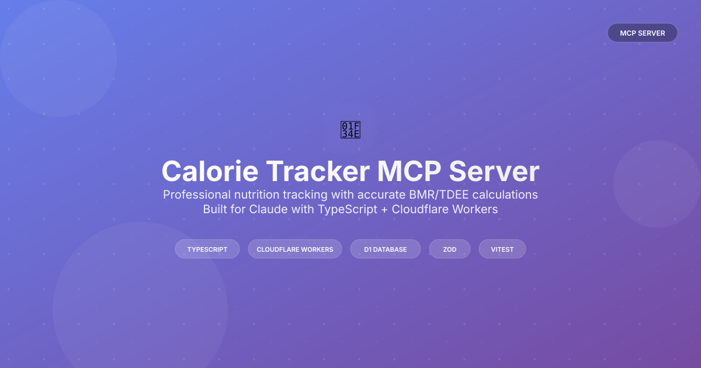

# Calorie Tracker MCP Server



MCP server for tracking daily calorie intake with accurate BMR/TDEE calculations. Built on Cloudflare Workers with D1 database.

## Features

- **Food Tracking**: Add, update, delete food entries with macros
- **Profile Management**: BMR/TDEE calculations using Mifflin-St Jeor equation
- **Historical Data**: Track weight, body composition over time
- **Secure**: OAuth 2.1 authentication with PKCE support

## Quick Setup

```bash
pnpm install

# Create resources and update wrangler.jsonc with IDs
npx wrangler d1 create calorie-tracker
npx wrangler kv:namespace create OAUTH_KV

# Run migrations and start dev server
npx wrangler d1 migrations apply calorie-tracker --local
pnpm run dev
```

## OAuth Client Registration

Set an admin API key:

```bash
# Development: Update wrangler.jsonc vars.ADMIN_API_KEY
# Production: Use secrets
npx wrangler secret put ADMIN_API_KEY
```

Register an OAuth client to obtain credentials:

```bash
curl -X POST http://localhost:8787/oauth/register \
  -H "Content-Type: application/json" \
  -H "X-API-Key: YOUR_ADMIN_API_KEY" \
  -d '{
    "client_name": "Claude Desktop",
    "redirect_uris": ["http://127.0.0.1/callback", "http://localhost/callback"],
    "user_id": "admin"
  }'
```

**Note**: Claude Desktop will specify its callback URL during the OAuth flow. If you get a redirect URI mismatch error, check Claude Desktop's OAuth logs for the actual callback URL it expects.

Response:

```json
{
  "client_id": "uuid-client-id",
  "client_secret": "generated-secret",
  "client_name": "Claude Desktop"
}
```

## Claude Configuration

### Option 1: Bearer Token (Personal/Pro/Max)

Simple authentication using client secret as bearer token:

1. **Register OAuth client**:

   ```bash
   curl -X POST http://localhost:8787/oauth/register \
     -H "Content-Type: application/json" \
     -H "X-API-Key: YOUR_ADMIN_API_KEY" \
     -d '{
       "client_name": "Claude Desktop",
       "redirect_uris": ["https://claude.ai/api/mcp/auth_callback"],
       "user_id": "admin"
     }'
   ```

   Save the `client_secret` from response.

2. **Claude Desktop config** (`claude_desktop_config.json`):

   ```json
   {
     "mcpServers": {
       "calorie-tracker": {
         "command": "npx",
         "args": ["mcp-remote", "http://localhost:8787/sse"],
         "env": {
           "BEARER_TOKEN": "<client_secret from registration>"
         }
       }
     }
   }
   ```

### Option 2: OAuth with Client Credentials (Team/Enterprise Only)

Private connector with Client ID/Secret:

1. **Register OAuth client** with callback URL `https://claude.ai/api/mcp/auth_callback`

2. **Add custom connector** in Claude:
   - **Name**: Calorie Tracker
   - **Remote MCP server URL**: `https://YOUR-WORKER.workers.dev/sse`
   - **OAuth Client ID**: `<client_id from registration>`
   - **OAuth Client Secret**: `<client_secret from registration>`

### Production Deployment

Deploy to Cloudflare Workers for mobile/web access:

```bash
pnpm run deploy
pnpm run migrate
npx wrangler secret put ADMIN_API_KEY
```

## Tools

**Food Tracking:**

- `list_entries` - List food entries with pagination
- `add_entry` - Add food entry with macros
- `update_entry` - Update existing entry
- `delete_entry` - Delete entry

**Profile Management:**

- `get_profile` - Get profile with BMR/TDEE calculations
- `update_profile` - Update profile data (height, weight, activity level)
- `get_profile_history` - Historical tracking data

**Admin:**

- `register_user` - Register new user
- `revoke_user` - Revoke user access

## BMR/TDEE Calculations

Uses Mifflin-St Jeor equation (gold standard):

**Male:** `BMR = (10 × weight) + (6.25 × height) - (5 × age) + 5`  
**Female:** `BMR = (10 × weight) + (6.25 × height) - (5 × age) - 161`

**TDEE:** `BMR × Activity Multiplier` (1.2 - 1.9)

## Development

```bash
pnpm test           # Run tests
pnpm run type-check # TypeScript validation
pnpm run deploy     # Deploy to production
pnpm run migrate    # Run migrations on remote
```

## Tech Stack

- **Runtime**: Cloudflare Workers
- **Database**: D1 (SQLite)
- **Language**: TypeScript
- **Validation**: Zod
- **Testing**: Vitest
